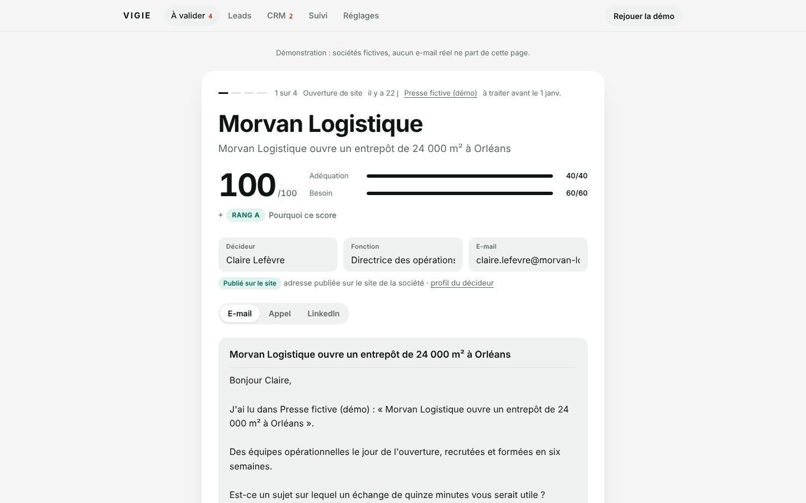
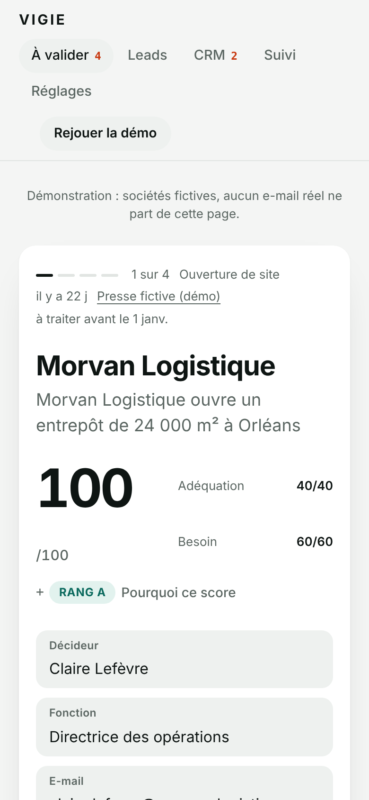

# Vigie — prospection B2B sur signaux, validée par un humain

[](https://github.com/Skysaks/VIGIE/actions/workflows/ci.yml)

> **EN** — A B2B prospecting cockpit: it spots buying signals (site openings, fundraising, hiring), scores each company on fit and need, drafts the e-mail, call script and LinkedIn note — and nothing leaves until a named person validates it.

**Démonstration** : [skysaks.github.io/VIGIE](https://skysaks.github.io/VIGIE/) · fichier autonome : [`dist/vigie.html`](dist/vigie.html) (à télécharger et ouvrir, hors ligne). Sociétés, personnes et adresses fictives (domaines `.example`).



> © 2026 Florian Iglesias — Tous droits réservés. Dépôt public à titre de portfolio uniquement : aucune licence n'est concédée. Voir [LICENSE](LICENSE).

## Le principe

La prospection automatisée envoie beaucoup et mal : messages génériques, chiffres inventés, contacts au mauvais moment. Vigie inverse la logique : **la machine trouve et prépare, un humain décide**.

1. Un **signal** daté et sourcé (ouverture de site, levée de fonds, recrutement…) fait entrer une société dans la file.
2. Le moteur la **note sur 100** : adéquation à la cible (40) et besoin probable (60), avec le détail de chaque point.
3. Il prépare un **e-mail, un script d'appel et une note LinkedIn**, puis les contrôle : tout chiffre du message absent de la source ou de l'offre est signalé, tout champ à compléter aussi.
4. **Une fiche à la fois**, l'utilisateur valide et envoie, valide seulement, fait réécrire, met en observation ou écarte avec un motif. Chaque décision est nominative et journalisée.

## Fonctionnalités

- **File du jour** bornée (10 fiches par défaut) : d'abord ce qui périme dans la semaine, puis les meilleurs scores ; chaque signal a une durée de vie selon son type.
- **Fiche** : signal cité avec sa source, score détaillé, décideur et statut de son adresse (vérifiée, publiée, saisie, générique, déduite), trois canaux de message, raccourci `⌘↵` pour valider et envoyer.
- **Garde-fous** : liste d'opposition, délai de carence entre deux contacts d'une même société, exclusions, validation impossible sans nom d'utilisateur.
- **CRM intégré** : pipeline par étapes, sociétés, tâches, chiffres ; exports CSV (leads, sociétés, contacts, opportunités) avec le serveur.
- **Suivi** : journal de toutes les décisions et rapport d'activité.
- **Réglages par espace de travail** : offre, proposition de valeur, cibles, signaux et leurs poids, ton et signature, seuils, sources ; enregistrement à la sortie de chaque champ.

| Ordinateur | Téléphone |
|---|---|
|  |  |

## Ce que contient ce dépôt

L'**interface** complète et un **moteur de démonstration embarqué** qui applique les mêmes règles que le serveur (statuts, file du jour, contrôle des brouillons, décisions nominatives, carence, opposition) sur un jeu de données fictif. Le serveur de production — collecte des signaux, enrichissement, vérification des adresses, envoi SMTP — n'est pas publié.

Le choix entre les deux se fait au démarrage : si la page embarque une graine de démonstration (`window.VIGIE_SEED`), chaque appel `api()` est servi par le moteur local ; sinon il part vers le serveur. Détail : [docs/ARCHITECTURE.md](docs/ARCHITECTURE.md).

## Construire et tester

Node 22 (voir `.nvmrc`). Aucune dépendance d'exécution ; Playwright sert uniquement aux tests.

```bash
npm ci
npm run dev        # http://localhost:5173, reconstruit à chaque modification de src/
npm run build      # src/ → dist/vigie.html (fichier unique)
npm run verify     # aucune ressource externe, budget de taille, aucune donnée personnelle
npm test           # tests d'intégrité (node:test) + parcours bureau et mobile (Playwright)
npm run captures   # régénère docs/captures/
```

## Structure du dépôt

```
src/
  index.html               gabarit : en-tête, navigation, ordre des modules
  styles/app.css           une colonne, une fiche à la fois ; thèmes clair et sombre
  data/graine-demo.js      jeu de données fictif de la démonstration
  js/
    01-base.js             état, statuts, file du jour, utilitaires
    02-messages.js … 11-evenements.js   accès aux données, rendu, gestes, leads, suivi, CRM, réglages
    12-moteur-demo.js      moteur embarqué : mêmes routes et mêmes règles que le serveur
    13-demarrage.js
dist/vigie.html            fichier construit, autonome (≈ 147 Ko)
scripts/  tests/  docs/
```

## Choix techniques

- **Une seule fonction `api()`** entre l'interface et les données : le moteur de démonstration implémente les mêmes routes (`/api/state`, `/api/lead/decision`, `/api/crm/board`…), ce qui permet de tester toute l'interface sans serveur.
- **Contrôle des brouillons par règle, pas par confiance** : un nombre qui n'apparaît ni dans la source ni dans l'offre est un avertissement visible avant validation.
- **Polices système** : aucune police embarquée, le fichier reste sous 150 Ko.

## Limites connues

1. **Démonstration seulement** : le moteur embarqué rejoue un jeu fixe ; aucune collecte réelle, aucun envoi.
2. **Serveur non publié** : la collecte, l'enrichissement et l'envoi ne sont pas dans ce dépôt.
3. **Tests automatiques sur Chromium** (bureau et mobile émulé) ; Safari et Firefox ne sont pas couverts par la CI.

## Sécurité et confidentialité

Aucune donnée réelle dans le dépôt : sociétés et personnes inventées, adresses sur le domaine réservé `.example`. Côté serveur, les requêtes d'écriture portent un en-tête dédié (`X-Vigie`) et une session expirée renvoie à la connexion. Signalement des failles : [SECURITY.md](SECURITY.md).

## Licence

© 2026 Florian Iglesias — Tous droits réservés ([LICENSE](LICENSE)). Contributions : [CONTRIBUTING.md](CONTRIBUTING.md).
