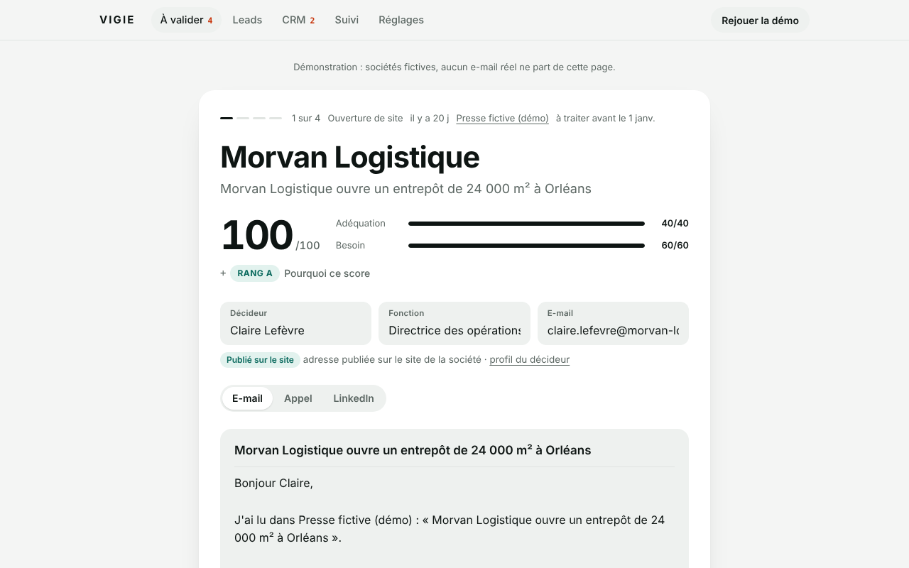

# VIGIE

Génération de leads B2B par signal : détecter les entreprises qui viennent de bouger, qualifier, enrichir, scorer. Rien ne part sans validation humaine.

## Fonctionnalités

- Chaîne complète : découvert, qualifié, enrichi, scoré, validé, campagne, suivi hebdomadaire
- File « À valider » : chaque signal arrive avec sa source, son score et un premier message prêt à relire
- Leads, CRM et suivi des campagnes
- Réglages : sources, seuils, ton, fournisseur de modèle (règles seules, modèle local ou API)

## Lancer

Ouvrir `index.html`. Toutes les sociétés et personnes affichées sont fictives ; aucun e-mail n'est envoyé.

## Technique

Interface monofichier en JavaScript sans dépendance, alimentée par un jeu de données de démonstration intégré. Le moteur de collecte, qui tourne en local, n'est pas inclus dans ce dépôt.

## Statut

Démonstration de l'interface.

## Droits

© 2026 Florian Iglesias – Tous droits réservés. Code publié à titre de présentation : aucune licence d'utilisation, de copie ou de redistribution n'est accordée.
